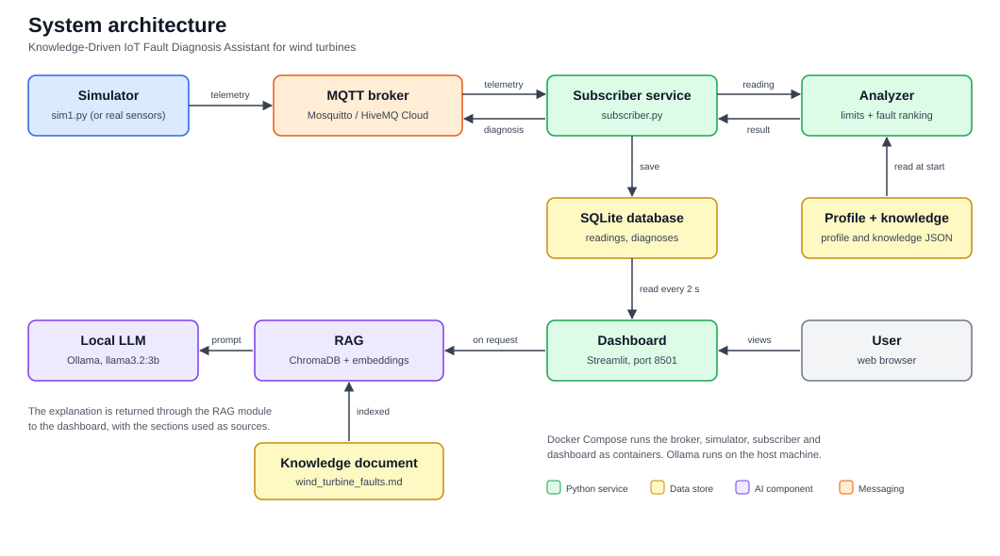
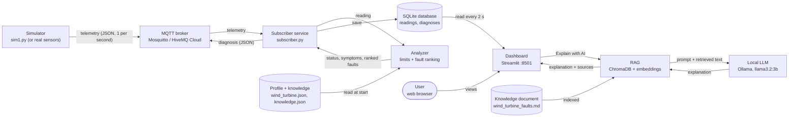
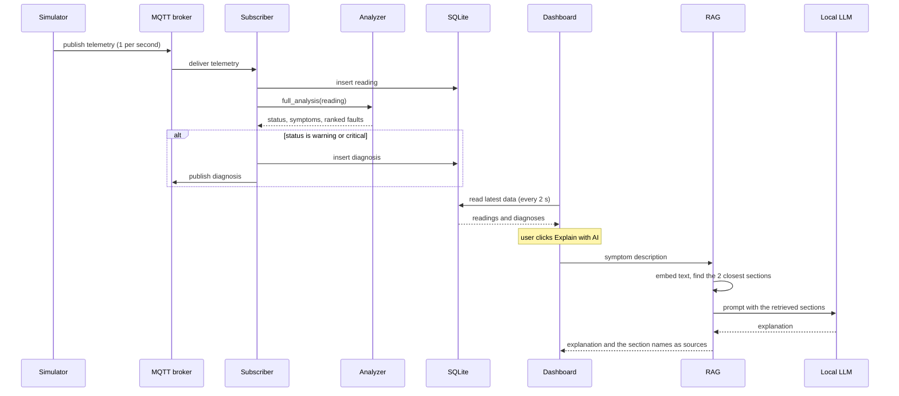
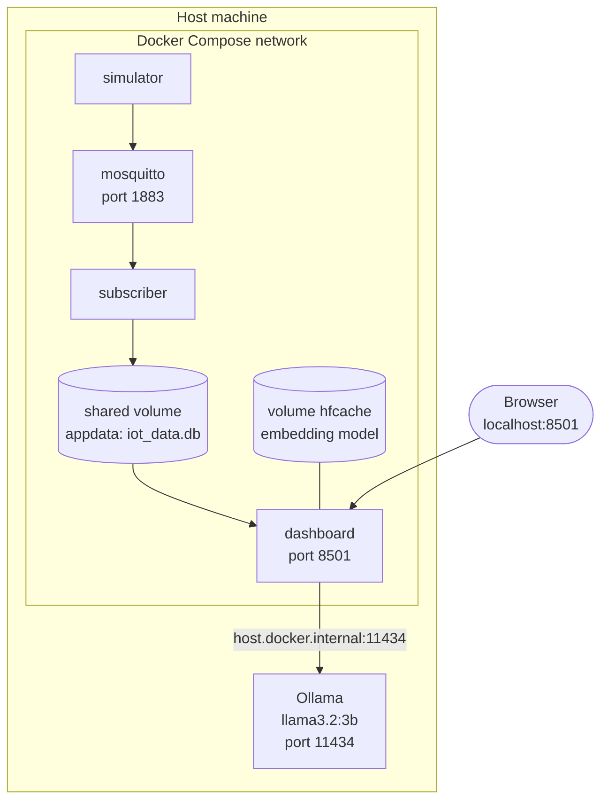

# Architecture Diagrams

This file collects the diagrams of the system. The text description of each component is in `03_System_Architecture.md`.

The Mermaid diagrams below are drawn automatically by GitHub and by VS Code's Markdown preview. A ready-made image of the main diagram is in `architecture.svg`, for tools that do not draw Mermaid and for use in reports.

---

## 1. System architecture

The same diagram in Mermaid:

## 2. Sequence of one diagnosis

## 3. Deployment with Docker Compose

The simulator, subscriber and dashboard are started from the same image, each with a different command.

## 4. Components at a glance

| Component | File | Role |
|---|---|---|
| Simulator | `simulators/sim1.py` | Publishes readings and injects faults |
| MQTT broker | Mosquitto container or HiveMQ Cloud | Delivers messages |
| Subscriber | `subscriber/subscriber.py` | Stores readings, runs the analyzer, publishes diagnoses |
| Analyzer | `analyzers/analyzer.py` | Detects abnormal values and ranks faults |
| Database | `iot_data.db` (SQLite) | Stores readings and diagnoses |
| RAG | `rag/build_index.py`, `rag/explain.py` | Indexes and retrieves knowledge, requests the explanation |
| Local LLM | Ollama | Writes the explanation |
| Dashboard | `dashboard/app.py` | Shows everything and triggers the explanation |
